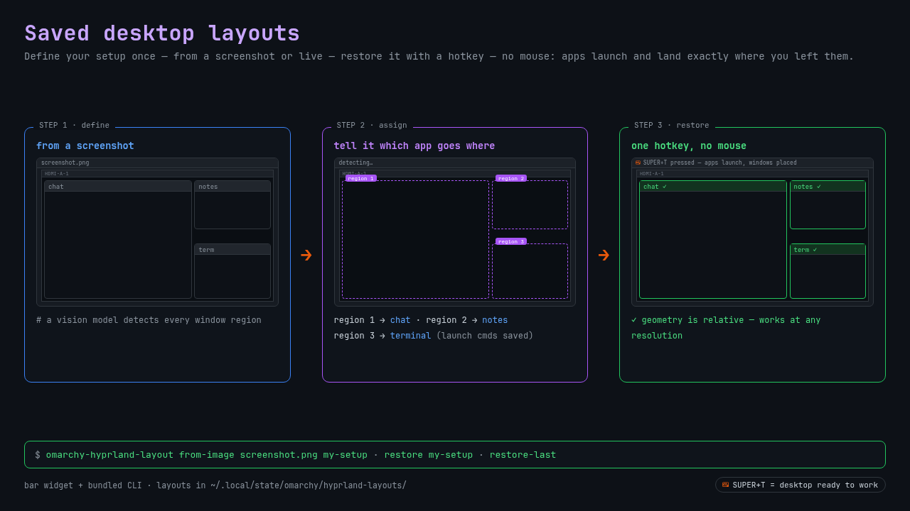

# Saved desktop layouts



Your ideal desktop shouldn't be a ritual of opening, dragging and resizing
every app by hand — every single time. Save your favorite arrangement once,
from a screenshot or your live desktop, and one click brings it back: missing
apps launch on their own, every window lands exactly where you placed it, at
exactly the size you set. Keep a saved layout for each thing you do — work,
study, gaming — and switch your whole desktop in one click, not ten minutes.

The bundled CLI (`bin/omarchy-hyprland-layout`) works on any Hyprland with the
Lua config API (Omarchy). Geometry is stored **relative** (percent of the
monitor), so a layout defined on one screen works at any resolution.

## How it works

```bash
# 1. Define a layout from a screenshot of an arrangement you like:
omarchy-hyprland-layout from-image screenshot.png my-setup
#    A vision model detects every window region; you tell it which app
#    belongs in each one (by name if it is running, or a launch command).

# 2. Restore it — assigned apps launch and land exactly where they belong:
omarchy-hyprland-layout restore my-setup

# Other commands:
omarchy-hyprland-layout save <name> [--all]   # snapshot the current desktop
omarchy-hyprland-layout restore-last          # most recent layout
omarchy-hyprland-layout list | delete <name>
```

Layouts are stored in `~/.local/state/omarchy/hyprland-layouts/`.

## Vision backend

`from-image` uses any OpenAI-compatible vision endpoint:

- `OMARCHY_LAYOUT_VISION_URL` — default `http://127.0.0.1:1234/v1` (LM Studio)
- `OMARCHY_LAYOUT_VISION_MODEL` — default: the first model the endpoint serves

`save` / `restore` need no model at all.

## Install

```bash
omarchy plugin add https://github.com/aishag80g-stack/omarchy-hyprland-layout --enable
```

Then add the widget to your bar (Omarchy menu → Bar → Widgets →
"Window layout restore"), or bind the CLI to a key directly, e.g. in
`~/.config/hypr/bindings.lua`:

```lua
o.bind("SUPER, T", "exec", "~/.config/omarchy/plugins/io.github.aishag80g-stack.hyprland-layout/bin/omarchy-hyprland-layout restore-last")
```

## Remove

```bash
omarchy plugin remove io.github.aishag80g-stack.hyprland-layout
```

Removal only deletes the plugin folder; your saved layouts stay in
`~/.local/state/omarchy/hyprland-layouts/` and are never touched.

## Dependencies

`bash`, `jq`, `curl`, `hyprctl` (Hyprland ≥ 0.56 Lua API), ImageMagick
(optional, downscales large screenshots), and an OpenAI-compatible vision
endpoint for `from-image` only.

## License

MIT — see [LICENSE](LICENSE).
